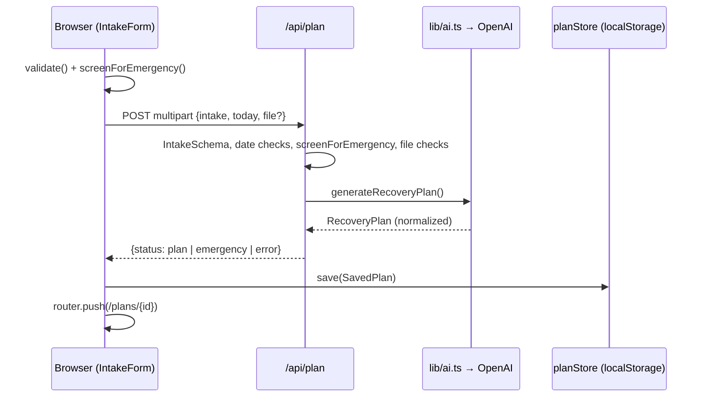

# Design: Recovery Plan MVP

## Overview

RecoverRight is a Next.js 16 (App Router, React 19, Tailwind 4) app with no accounts and no database. The browser collects and validates the intake, runs an emergency screen, and posts multipart data to a server route. The server validates again, screens again, and calls OpenAI (Responses API, strict structured output via zod). The plan returns to the browser, which saves it in localStorage and renders it in tabs. Follow-up chat sends the saved plan back to a stateless chat route on each question.

## Architecture

| Layer | Files | Responsibility |
| --- | --- | --- |
| Pages | `app/page.tsx`, `app/intake/page.tsx`, `app/plans/page.tsx`, `app/plans/[id]/page.tsx` | Landing, intake, plan list, plan view shells |
| Components | `components/IntakeForm.tsx`, `GeneratingPlan.tsx`, `EmergencyNotice.tsx`, `Disclaimer.tsx`, `PlansList.tsx`, `components/plan/*` | UI and client logic |
| API routes | `app/api/plan/route.ts`, `app/api/chat/route.ts` | Validation, emergency screen, call AI |
| AI | `lib/ai.ts` (`server-only`) | Prompts, OpenAI client, error mapping |
| Domain | `lib/intake.ts`, `lib/emergency.ts`, `lib/plan-schema.ts`, `lib/therapies.ts`, `lib/dates.ts`, `lib/api-types.ts` | Schemas, rules, curated content |
| Storage | `lib/storage.ts` | `PlanStore` interface, localStorage implementation |

## Components and interfaces

### Intake (`components/IntakeForm.tsx`, `lib/intake.ts`)

- Stages: `form` → `loading` → (`emergency` | `error` | redirect).
- Upload mode by default; `describing` toggles the `diagnosisText` textarea. `chooseFile` enforces `ALLOWED_UPLOAD_TYPES` (jpeg, png, webp, pdf) and `MAX_UPLOAD_BYTES` (10 MB).
- `validate()` runs required-field checks, future-date checks, `IntakeSchema.safeParse`, the file-or-description rule, and the acknowledgement rule.
- `generate()` posts `FormData {intake, today, file?}` with a 5-minute `AbortController` timeout, then calls `planStore.save` and navigates. `retry()` resubmits the last submission.
- `IntakeSchema` refines that `diagnosisText` or `uploadedFileName` is present.

### Emergency screen (`lib/emergency.ts`, `components/EmergencyNotice.tsx`)

- `screenForEmergency(intake) → {isEmergency, reasons}` is pure and runs in both browser and server.
- Reasons come from checked `EMERGENCY_SYMPTOMS` labels and 9 regex `PATTERNS` over notes + goal + diagnosis, skipping matches whose preceding 40 characters hit `NEGATION` or `HYPOTHETICAL`.
- `EmergencyNotice({reasons, onBack?})` renders the 911 guidance.

### Plan route (`app/api/plan/route.ts`, `maxDuration = 300`)

1. Reject content-length > 10 MB + 200 KB (413).
2. Parse form data and intake JSON; `IntakeSchema.safeParse` (400).
3. `todayIso` = client `today` if within ±1 day of server date, else server date. Reject future injury/surgery dates.
4. `screenForEmergency` → `{status: "emergency"}`.
5. Validate file type (415) and size (413); build `UploadedDocument {filename, mimeType, base64}`. Reject a declared upload that didn't arrive (400).
6. `computePlanTiming` → `generateRecoveryPlan`.
7. `urgentCare.needed` → emergency; `cannotCreatePlanReason` → 422; else `{status: "plan", plan, planStartDate, planStartAnchor}`. `AIError` → its message and status.

### AI (`lib/ai.ts`)

- Client: `OPENAI_API_KEY` required; timeout 240 s, 1 retry. Model `OPENAI_MODEL` (default `gpt-6.1-sol`).
- `SAFETY_RULES` shared by all prompts: educational only, no invented citations, no dosing for unapproved substances or any medication, no changing prescribed treatment, flag emergencies, ~8th-grade reading level.
- `PLAN_INSTRUCTIONS` embeds `therapyCatalog()` so the model can only pick curated therapy ids.
- `generateRecoveryPlan`: `responses.parse` with `zodTextFormat(RecoveryPlanSchema)`, reasoning effort low, 32k output tokens, `store: false`. PDFs go as `input_file`, images as `input_image` (detail high). Incomplete → 502, unparsed → 422.
- `normalizePlan`: sorts phases, re-chains week ranges from 1, forces the last phase to end at week 20, dedupes therapy ids.
- `answerPlanQuestion`: `responses.create` with plan JSON, curated therapy facts, and person details; 4k tokens; empty reply → 502.
- `toAIError`: timeout 504, connection 502, 401/403 → 500 (bad key), 404 → 500 (model), 429, 400 (bad file), other → 502.

### Chat (`app/api/chat/route.ts`, `components/plan/PlanChat.tsx`)

- Route: max body 400,000 chars; `ChatRequestSchema {plan, intake, planStartDate, messages}`; keep last 16 messages; trim leading assistant messages; last message must be a user message ≤ 2000 chars; current week from server date, capped at 20.
- Client: optimistic append, rollback on error, `planStore.updateChat` on success, 4 suggestion chips, "Clear chat" with confirm. Hidden in print.

### Plan view (`components/plan/PlanView.tsx`, `sections.tsx`, `EvidenceBadge.tsx`)

- Loads via `planStore.get(id)`; states `loading | missing | error | ready`.
- `currentWeek = max(1, weekNumber(planStartDate, today))`.
- `TABS`: overview, timeline, exercises (with `GuidedSessionPanel`), surgery, therapies, lifestyle, redflags, questions. Each panel is `role="tabpanel"`; hidden panels use `hidden print:block`.
- `TherapiesSection` resolves each id via `getTherapy` and renders `EvidenceBadge` with `EVIDENCE_LABELS`.
- PDF export: `window.print()` with Tailwind `print:` utilities. No PDF library.

### Storage (`lib/storage.ts`)

- Key `recoverright:plans:v1`, JSON array of `SavedPlan {version: 1, id, createdAt, planStartDate, planStartAnchor, intake, plan, chat, sessions}`.
- `PlanStore`: `list`, `get`, `save`, `updateChat`, `addSession`, `remove`. `list` returns `PlanSummary` newest first.
- `readRaw` keeps invalid entries for writes; `readValid` filters with `safeParse`. Failures throw `StorageError` with user-facing messages.
- `planStore = createLocalStoragePlanStore()` is the single swap point for a future database.

## Data models

- `Intake` (`lib/intake.ts`): diagnosisText, dateOfInjury, age, activityLevel, sport, surgeryStatus, surgeryDate, painLevel, mainGoal, symptomsNotes, emergencySymptoms, acknowledged, uploadedFileName.
- `RecoveryPlan` (`lib/plan-schema.ts`): cannotCreatePlanReason, urgentCare, title, injuryName, summary, paperworkFindings, assumptions, overview, phases (`Phase` with `Exercise[]`), homeExerciseGuidance, stopExerciseWarningSigns, surgery, alternativeTherapies `{therapyId, whyRelevant}`, lifestyle, redFlags, questionsForDoctor, questionsForPT. Optional values are nullable because strict structured output requires every field.
- `AlternativeTherapy` (`lib/therapies.ts`): 24 curated entries with `evidenceLevel` (strong | emerging | experimental), risks, cost, regulatory status, `unapproved` flag.
- `PlanTiming` (`lib/dates.ts`): planStartDate, anchor, currentWeek; `PLAN_WEEKS = 20`.
- API responses (`lib/api-types.ts`): `PlanApiResponse` (plan | emergency | error), `ChatApiResponse` (ok | error).

## Error handling

- Client and server validate the same zod schemas; the server returns the first issue message.
- AI failures map to friendly `AIError` messages; the client keeps answers and offers retry.
- Storage failures surface as `StorageError` messages; a generated plan that can't be saved is reported.
- Emergency responses use HTTP 200 with `status: "emergency"`.

## Security and privacy

- `lib/ai.ts` is `server-only`; the API key never reaches the browser.
- Uploads are sent to OpenAI for one request with `store: false` and never persisted.
- No server-side storage of plans or chats; everything lives in the browser.
- Therapy facts come only from the curated list; the model cannot add therapies or claims.

## Testing strategy

There is no automated test framework in the project. Verification today is manual: run `npm run dev`, submit intakes with an upload and with a description, trigger the emergency screen with checked symptoms and keywords (including negated phrases), check every tab, chat, save/delete, and print preview. `npm run lint` and `npm run build` provide static checks.

## Known limitations

- Item counts in the schema (phases 3–5, therapies 4–8, etc.) are guidance in `.describe()` text, enforced only by the prompt and `normalizePlan`.
- The emergency keyword screen is English-only.
- HEIC uploads are not supported.
- Plans exist only in one browser.
- The chat route uses server time for the current week; the plan route uses the client's date.
- Therapy content needs clinician review before launch.
